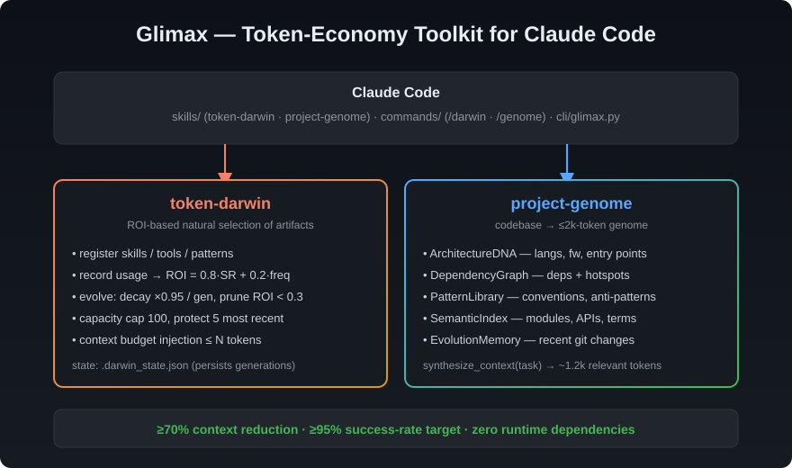
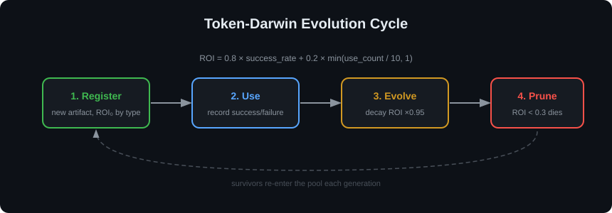
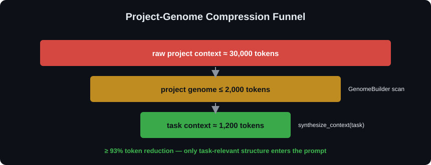

# Glimax

**Token-economy toolkit for Claude Code** — ROI-based artifact evolution and project-context compression. Two engines, one goal: keep your context window lean while your agent's knowledge compounds.

[](#testing)
[](https://www.python.org/)
[](#requirements)
[](LICENSE)
[](https://docs.claude.com/en/docs/claude-code/plugins)

<p align="center">
  
</p>

---

## Contents

- [Why Glimax](#why-glimax)
- [What's Inside](#whats-inside)
- [Install](#install)
- [Quick Start](#quick-start)
- [CLI Reference](#cli-reference)
- [How It Works](#how-it-works)
- [Configuration](#configuration)
- [Repository Structure](#repository-structure)
- [Testing](#testing)
- [Requirements](#requirements)
- [License](#license)

---

## Why Glimax

Every long-running agent session fights the same enemy: the context window fills with stale skills, dead-end patterns, and raw project dumps. Most teams respond by dumping *more* text into the prompt. Glimax does the opposite:

1. **token-darwin** treats every reusable artifact as an organism. Each has a fitness score (ROI) computed from real usage outcomes. Low-fitness artifacts decay every generation and die below a threshold. Only proven artifacts earn context budget.
2. **project-genome** compresses a full project scan (≈30,000 tokens) into a structured genome of ≤2,000 tokens, then synthesizes a task-specific context of ≈1,200 tokens on demand.

Measured on this repository's own layout, `genome metrics` reports:

```json
{"genome_tokens": 345, "synthesized_tokens": 238, "baseline_estimate": 30000, "token_reduction_pct": 98.9, "within_budget": true}
```

## What's Inside

| Component | Type | Purpose |
|---|---|---|
| `token-darwin` | skill + engine | ROI-based natural selection over skills, tools, patterns, context snippets |
| `project-genome` | skill + engine | Codebase → ≤2k-token genome → ≈1.2k-token task context |
| `/darwin` | slash command | Drive token-darwin from inside Claude Code |
| `/genome` | slash command | Drive project-genome from inside Claude Code |
| `cli/glimax.py` | CLI | Single entry point for both engines, scriptable from any harness |

## Install

### Option 1 — Claude Code plugin marketplace

```text
/plugin marketplace add CodebyKDvn/glimax
/plugin install glimax
```

This registers both skills and the `/darwin` / `/genome` slash commands in one step.

### Option 2 — manual clone

```bash
git clone https://github.com/CodebyKDvn/glimax.git
cd glimax
```

Then run the engines directly:

```bash
python cli/glimax.py darwin metrics
python cli/glimax.py genome build .
```

## Quick Start

**Register an artifact, use it, and watch it evolve:**

```bash
python cli/glimax.py darwin register demo_skill skill --content "A reusable skill."
# {"id":"f82e1328b7a2","name":"demo_skill","type":"skill","roi":0.5,"token_cost":5}

python cli/glimax.py darwin use f82e1328b7a2 true
python cli/glimax.py darwin evolve
python cli/glimax.py darwin list
```

**Build a project genome and pull task context:**

```bash
python cli/glimax.py genome build .
python cli/glimax.py genome context "refactor the CLI argument parsing"
python cli/glimax.py genome metrics .
```

## CLI Reference

All commands run through a single entry point:

```bash
python cli/glimax.py <engine> <action> [args]
```

### token-darwin

| Command | Description |
|---|---|
| `darwin register <name> <type> [--content TEXT \| --file PATH]` | Register a new artifact. `type` ∈ `skill`, `tool`, `pattern`, `context_snippet` |
| `darwin use <artifact_id> <true\|false>` | Record an honest usage outcome |
| `darwin evolve` | Apply decay (×0.95) and prune artifacts below ROI threshold |
| `darwin list [--type TYPE]` | List artifacts, optionally filtered by type |
| `darwin context [--max-tokens N]` | Print the highest-ROI artifacts within a token budget (default 800) |
| `darwin metrics` | Print pool statistics |

State persists in a JSON file (`--state PATH`, default `.darwin_state.json` in the working directory), so generations carry across sessions per project.

### project-genome

| Command | Description |
|---|---|
| `genome build [PROJECT_PATH]` | Scan the project and build the genome (default `.`) |
| `genome context <task> [PROJECT_PATH]` | Synthesize a task-specific context block |
| `genome metrics [PROJECT_PATH]` | Print compression statistics |

## How It Works

### token-darwin: the evolution cycle

<p align="center">
  
</p>

Every artifact carries an ROI score:

```
roi = 0.8 × success_rate + 0.2 × min(use_count / 10, 1)
```

- **Success rate dominates** — an artifact that fails is dying, no matter how often it is used.
- **Decay**: each `evolve` generation multiplies ROI by `0.95`. Unused artifacts drift toward the prune threshold on their own.
- **Pruning**: artifacts below `roi_threshold` (0.3) are removed at `evolve` time, except the `protect_recent` (5) most recently used.
- **Capacity**: the pool is capped at 100 artifacts; the weakest make room for the new.
- **Context injection**: `darwin context` sorts survivors by ROI and emits only what fits the token budget.

### project-genome: the compression funnel

<p align="center">
  
</p>

The genome is five named sections with fixed token budgets:

| Section | Budget | Captures |
|---|---|---|
| `ArchitectureDNA` | 400 | Languages, frameworks, entry points |
| `DependencyGraph` | 500 | Dependencies and hotspot modules |
| `PatternLibrary` | 400 | Conventions and anti-patterns |
| `SemanticIndex` | 400 | Modules, APIs, domain terms |
| `EvolutionMemory` | 300 | Recent change history |

`synthesize_context(task)` then selects the task-relevant slices and produces ≈1,200 tokens. Design targets: **≥70% token reduction**, **≥95% task-success rate**, genome ≤2,000 tokens.

## Configuration

Each engine ships a `config.yaml` next to its module:

- [src/token_darwin/config.yaml](src/token_darwin/config.yaml) — `roi_threshold: 0.3`, `decay_rate: 0.95`, `max_artifacts: 100`, `protect_recent: 5`, context budget
- [src/project_genome/config.yaml](src/project_genome/config.yaml) — per-section token budgets, scan depth, targets

The engines load config at construction time; the factory function `create_plugin(config_path[, state_path])` is the stable entry point for embedding either engine in your own tooling.

## Repository Structure

```
glimax/
├── .claude-plugin/
│   ├── plugin.json            # Claude Code plugin manifest
│   └── marketplace.json       # marketplace listing
├── skills/
│   ├── token-darwin/SKILL.md
│   └── project-genome/SKILL.md
├── commands/
│   ├── darwin.md              # /darwin slash command
│   └── genome.md              # /genome slash command
├── cli/
│   └── glimax.py              # single CLI entry point
├── src/
│   ├── token_darwin/          # engine + config.yaml
│   └── project_genome/        # engine + config.yaml
├── tests/                     # 56 unit tests
├── assets/                    # diagrams
├── LICENSE                    # MIT
└── README.md
```

## Testing

```bash
cd glimax
python3 -m unittest discover -s tests -v
```

```
Ran 56 tests in 0.167s

OK
```

No pytest, no fixtures framework — plain `unittest` so the suite runs on a bare Python install.

## Requirements

- Python ≥ 3.9 (developed on 3.14)
- **Zero required dependencies** — stdlib only. PyYAML is used opportunistically for `config.yaml` if installed; a built-in fallback parser covers its absence.

## License

[MIT](LICENSE) © 2026 CodebyKDvn