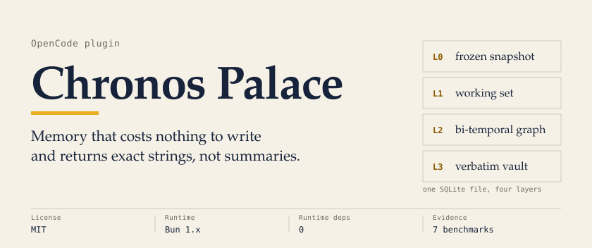
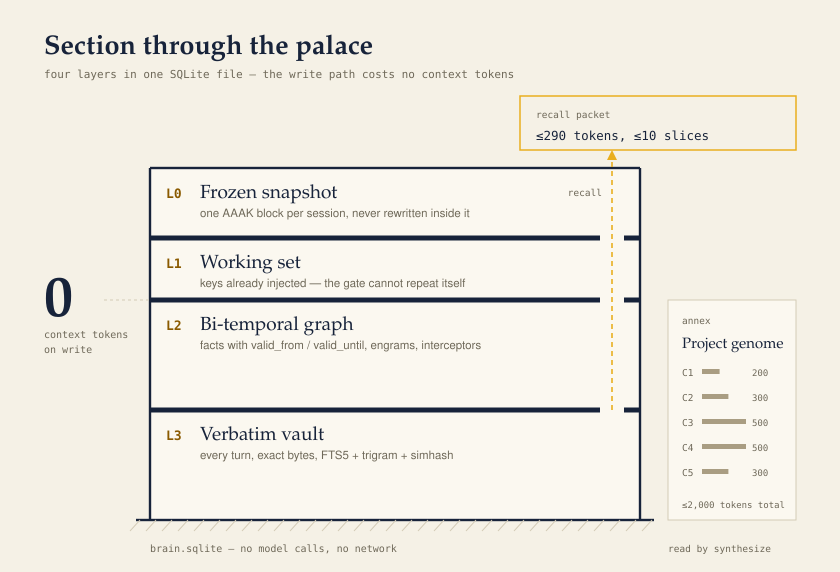
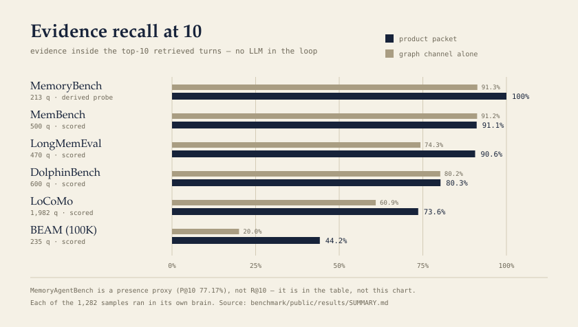

<picture>
  <source media="(prefers-color-scheme: dark)" srcset="docs/assets/readme/banner-dark.svg">
  <source media="(prefers-color-scheme: light)" srcset="docs/assets/readme/banner-light.svg">
  
</picture>

Chronos Palace is a memory plugin for [OpenCode](https://opencode.ai). It records what happens in a session — raw turns, facts, project state, failure → fix pairs — into a local SQLite file, then hands it back later as a short packet of exact stored lines.

No model runs when it writes. Nothing is summarised away.

| tokens | path |
|--:|:--|
| **0** | prompt and tool hooks — store turns, facts, lessons, project state |
| **< 125** | every model call — one frozen block, byte-identical for the whole session |
| **≤ 290** | `chronos` recall — up to 10 evidence slices, exact strings |
| **≤ 1,700** | `chronos` synthesize — five-chromosome genome + top-3 code slices |

## The palace

<picture>
  <source media="(prefers-color-scheme: dark)" srcset="docs/assets/readme/palace-dark.svg">
  <source media="(prefers-color-scheme: light)" srcset="docs/assets/readme/palace-light.svg">
  
</picture>

Writes land in **L3** as raw bytes. The extractor derives facts and bi-temporal edges in **L2** — `valid_from`, `valid_until`, `superseded_by` — without calling a model. **L1** remembers which keys were already injected, so the gate cannot repeat itself. **L0** freezes one block per session; because the bytes never change inside a session, the block stays cacheable.

The same extractor reads the workspace on its own: `package.json`, git branch, README. A project has an identity before you explain it.

Every entry point is defensive. A damaged brain degrades to a normal session instead of a crashed one.

## Evidence

<picture>
  <source media="(prefers-color-scheme: dark)" srcset="docs/assets/readme/evidence-dark.svg">
  <source media="(prefers-color-scheme: light)" srcset="docs/assets/readme/evidence-light.svg">
  
</picture>

| benchmark | n | score |
|:--|--:|--:|
| MemoryBench (THUIR) — derived probe | 213 | **100%** R@10 |
| MemBench — scored | 500 | **91.10%** R@10 |
| LongMemEval — scored | 470 | **90.64%** R@10 |
| DolphinBench — scored | 600 | **80.29%** R@10 |
| LoCoMo — scored | 1,982 | **73.62%** R@10 |
| MemoryAgentBench — presence proxy | 3,500 | **77.17%** P@10 |
| BEAM (100K) — scored | 235 | **44.20%** R@10 |

This is retrieval level only: it asks whether the packet contains the evidence a model would need to answer. No LLM is in the loop, and these are not the benchmarks' official end-to-end scores. `n` is the number of questions scored in this run — for BEAM, LoCoMo and LongMemEval, the subset that carries gold evidence.

Three rows need a caveat. MemoryBench is a derived continuity probe — the official protocol needs an LLM judge. MemoryAgentBench publishes no evidence labels, so it is scored as answer-string presence. BEAM at 100K is scored, but 44.20% is the weak spot and the honest number: those questions ask for a summary of a long session, and summarisation is a ceiling for retrieval.

Full tables, latency and packet sizes: [`benchmark/public/results/SUMMARY.md`](benchmark/public/results/SUMMARY.md). How a run works: [`benchmark/public/README.md`](benchmark/public/README.md).

## What we rejected

The v7 layer (`omni.ts` + `planner.ts`) builds five cognitive indexes — entity graph, timeline, state ledger, facet index, causal episodes — and a six-operator planner that reallocates the packet slots. It was evaluated in the benchmark harness and **never wired into the plugin's recall path**: `CHRONOS_OMNI=1` enables it there, and it measured worse than the lexical head it would replace.

| operator | precision@12 on BEAM |
|:--|--:|
| temporal | 22% |
| set-cover | 8% |
| graph PPR | 6% |
| facet | 2% |
| state | 0% |

On LoCoMo multi-hop questions, graph PPR alone reached 11.2% R@10 against 50.3% for the lexical/semantic union; fusing the two added nothing. End to end, the planner moved LoCoMo from 73.67% to 73.58%.

A slot given to an operator is a slot taken from evidence that works. The measurements and the decision are in [`benchmark/public/results/OMNI.md`](benchmark/public/results/OMNI.md).

## Install

Requires OpenCode v2 — the plugin uses the v2 `session.hook` and `tool.transform` APIs. Built and tested on Linux with Bun 1.4.3.

1. Clone it beside your config:

   ```bash
   git clone https://github.com/CodebyKDvn/glimax.git \
     ~/.config/opencode/plugin/chronos-memory
   ```

2. Register the directory. Relative paths resolve from the config file that contains them:

   ```jsonc
   // ~/.config/opencode/opencode.jsonc
   {
     "$schema": "https://opencode.ai/config.json",
     "plugins": ["./plugin/chronos-memory"]
   }
   ```

3. Restart OpenCode. No `bun install` is needed for the plugin itself: it imports only `node:*` and `bun:sqlite`.

State lives in `~/.local/share/opencode/chronos-memory/brain.sqlite`; the file is created when the plugin loads (`ls ~/.local/share/opencode/chronos-memory/brain.sqlite`). Set `CHRONOS_BRAIN_PATH` to put it elsewhere. Project-local installs work the same way: put the directory under `.opencode/plugins/` and OpenCode loads it automatically.

## Use

You ask in your own words and the agent calls `chronos`. Modes:

| mode | what it returns |
|:--|:--|
| `recall` | facts, verbatim evidence and learned reflexes for a question |
| `timeline` | how a project or a habit evolved, including what was dropped |
| `remember` | record a milestone, focus, open loop or fact now |
| `reflex` | cortex stats; `activate <macro_id>`, or teach `A -> B` |
| `genome` | the project's five chromosomes and their token budgets |
| `synthesize` | task packet: genome plus top-3 code slices by line range |
| `darwin` | ROI audit: ranking, pruning, caps |

> why did we drop the Redis cache?

```text
[CHRONOS|recall|f0 v7 r0]
[V#1|2026-10-16|usermsg|…at 480ms p95. We're adding a Redis cache in front…]
[V#3|2026-10-17|usermsg|Cache is in. p95 dropped to 190ms but now stale to…]
[V#2|2026-10-16|bashcmd|bun add ioredis && redis-server --port 6380]
[V#4|2026-10-17|usermsg|Ripping Redis out. Going with a Postgres read repl…]
[V#5|2026-10-18|usermsg|…210ms and refunds are correct. Keeping the cache o… ⧉ Replica]
[V#7|2026-10-20|usermsg|Index got p95 to 165ms. That's the win. Redis stay…]
[V#6|2026-10-19|bashcmd|psql -c 'create index concurrently orders_customer…']
```

That is real output from a seeded demo brain (7 turns, 161 tokens). The header counts facts, verbatim lines and reflexes; each `V#` line points back to a stored turn, so the agent can quote the decision instead of paraphrasing it.

## How it works

| module | role |
|:--|:--|
| `db.ts` | SQLite schema: L3 vault, L2 graph, episodic projects, genomes |
| `index.ts` | plugin hooks and the `chronos` tool |
| `retriever.ts` | T-RRF over graph edges, recency decay, the frozen snapshot |
| `extractor.ts` | out-of-band entity and relation extraction — deterministic, no network |
| `aaak.ts` | query analysis, calibrated merge, token estimation |
| `strategy.ts` | intent routing and non-similarity evidence selection |
| `genome.ts` | five-chromosome project genomes, capped at 2,000 tokens |
| `darwin.ts` | ROI bookkeeping, nightly pruning, budget enforcement |
| `cortex.ts` | reflex engrams and the `tool.execute.before` interceptors |
| `omni.ts`, `planner.ts` | the v7 layer, evaluated in the harness — not in the recall path |

Built against the OpenCode v2 hook API (`session.hook`, `tool.transform`). The V1 hook names were removed in OpenCode v2.

## Limits

- Retrieval only. Answer quality, latency of a downstream model and prompt-cache hit rates are not measured here.
- BEAM 100K is weak by construction: the questions need summarisation across a long session.
- One brain per user, on local disk. No sync, no sharing between agents.
- The semantic channel belongs to the benchmark harness (`@xenova/transformers`, a dev dependency). The plugin itself stays lexical and dependency-free.

## Development

```bash
bun test ./test.ts     # 24 tests, 226 assertions, ~0.2 s
```

The suite runs against a temporary brain, never your live one. Benchmarks need their datasets prepared first — the corpora are not committed; see [`benchmark/public/README.md`](benchmark/public/README.md).

Bugs and questions: [open an issue](https://github.com/CodebyKDvn/glimax/issues).

## License

MIT — see [LICENSE](LICENSE).
