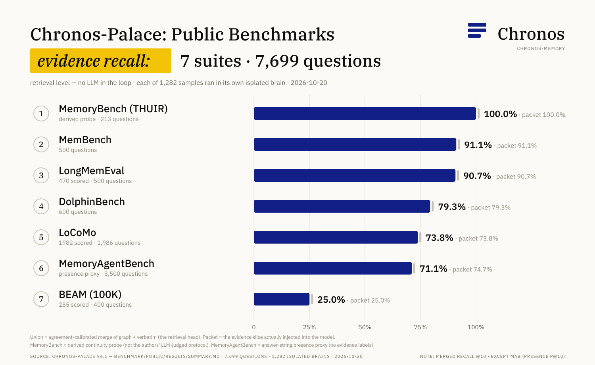
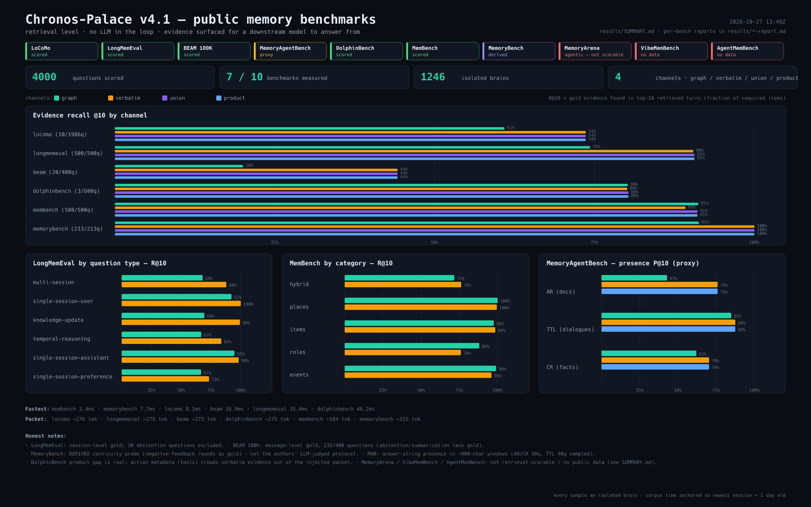

# Chronos-Palace v4.1 — benchmark results (retrieval level)

_generated 2026-10-27T13:49Z_

Scope: **retrieval level only** — can the memory subsystem surface the evidence a
downstream LLM would need to answer? No LLM is in the loop; these numbers are
not the official end-to-end scores of the benchmarks below.

## Coverage of the ten requested benchmarks

| # | benchmark | status | protocol / note |
|--:|-----------|--------|-----------------|
| 1 | LoCoMo | scored | turn-level gold evidence (dialog ids) |
| 2 | LongMemEval | scored | session-level gold evidence |
| 3 | BEAM (100K) | scored | message-level gold (source_chat_ids; 235/400 questions) |
| 4 | MemoryAgentBench (AR/TTL/CR) | proxy | no evidence labels → answer-string presence in ~900-char windows (AR/CR 30q, TTL 40q per instance; sampled) |
| 5 | DolphinBench | scored | message-level gold (required facts → source messages) |
| 6 | MemBench (import-myself) | scored | message-level gold (QA.target_step_id) |
| 7 | MemoryBench (THUIR) | derived | DERIVED continuity probe: negative-feedback rounds as gold (official protocol needs an LLM judge; not the authors' metric) |
| 8 | MemoryArena | not scorable | multi-session AGENTIC tasks: needs an executor + tool environment; no retrieval labels. Data downloaded (5 families). |
| 9 | VibeMemBench | no public data | repo dir (AlibabaResearch/DAMO-ConvAI) is a 100-byte README stub as of 2026-10-17. |
| 10 | AgentMemBench | no public data | no code/data release located as of 2026-10-17. |

## Headline numbers (scored/proxy/derived benches)

| benchmark | samples | questions | gold | graph R@10 | verbatim R@10 | union R@10 | product R@10 | product MRR | packet tok (mean) |
|-----------|--------:|----------:|------|-----------:|--------------:|-----------:|-------------:|------------:|------------------:|
| locomo | 10 | 1986 | 1982/1986 | 60.92% | 73.64% | 73.62% | 73.62% | 0.49 | 276 |
| longmemeval | 500 | 500 | 470/500 | 74.29% | 90.45% | 90.64% | 90.64% | 0.88 | 275 |
| beam | 20 | 400 | 235/400 | 20.04% | 44.20% | 44.20% | 44.20% | 0.39 | 275 |
| dolphinbench | 3 | 600 | scored | 80.21% | 80.12% | 80.29% | 80.29% | 0.58 | 275 |
| membench | 500 | 500 | scored | 91.23% | 89.23% | 91.10% | 91.10% | 0.60 | 184 |
| mab | 36 | 3500 | scored | — | — | — | — | — | 275 |
| memorybench | 213 | 213 | scored | 91.31% | 100% | 100% | 100% | 0.54 | 155 |

### Answer-string presence (weak proxy — subset of MemoryAgentBench)

Fraction of accepted answer strings visible in the retrieved context (the model could answer from it):

| benchmark | channel | P@1 | P@10 |
|-----------|---------|----:|-----:|
| mab | graph | 34.27% | 65.47% |
| mab | verbatim | 45.32% | 77.17% |
| mab | product | 45.32% | 77.17% |

## Notes

- mab-lru: skipped: summarization split; presence proxy meaningless
- `r1..r50` (structural benches) = mean fraction of the required gold evidence found in top-k.
- `union` = agreement-calibrated merge of graph + verbatim (top-12). `product` = the actual recall packet the plugin injects.
- Every sample ran in its own isolated brain; corpus time anchored so the newest session is ~1 day old.
- Per-bench detail (per-question-type tables, latency, packet size): `results/<bench>-report.md`.
- v7.0 cognitive indexes (opt-in, `CHRONOS_OMNI=1`) and why they are not in the default path: `results/OMNI.md`.

## Per-bench reports

- [locomo](locomo-report.md)
- [longmemeval](longmemeval-report.md)
- [beam](beam-report.md)
- [dolphinbench](dolphinbench-report.md)
- [membench](membench-report.md)
- [mab](mab-report.md)
- [memorybench](memorybench-report.md)
