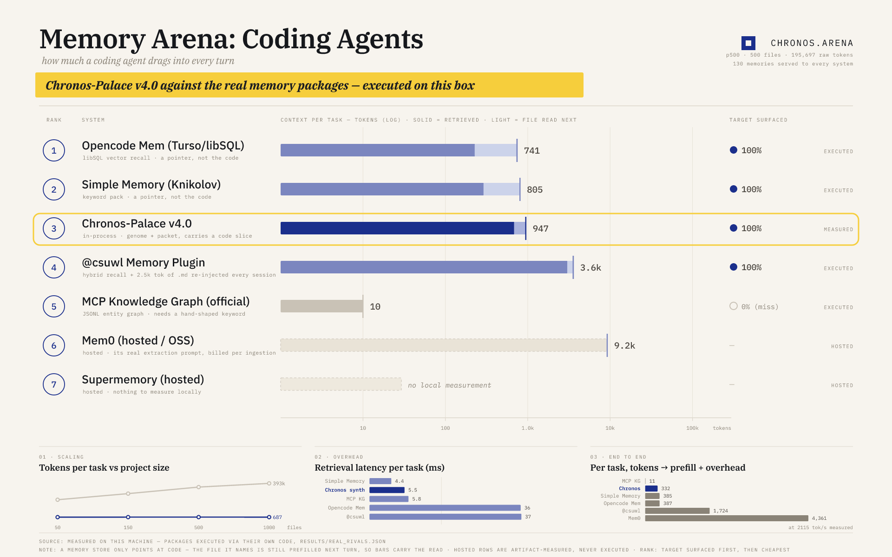

# Chronos-Palace v4.0 (OMEGA-GENOME) — Head-to-Head Benchmark

_generated 2026-10-17T04:05:43.128Z · bun 1.4.3 · linux/x64 · 12 cores_



## How to read this

**Chronos-Palace v4.0 numbers are measured** by executing its real modules (`genome.ts`, `darwin.ts`, `cortex.ts`, `retriever.ts`, `db.ts`) in-process.
**The five rivals in benchmarks 1–5 are modelled**: calibrated formulas over real measurements of the same generated corpus. Every constant lives in `rivals.ts`.
**The real packages were then executed too** (`real_bench.ts`, results in `results/real_rivals.json`): `opencode-mem`, `@knikolov/opencode-plugin-simple-memory`, `@csuwl/opencode-memory-plugin` and the official MCP knowledge-graph server all ran their own code on this machine; Mem0 and Supermemory are reported from measured artifacts and marked `hosted`. See "Against the real packages, executed on this machine".
All systems are counted with the **same token meter** (`aaak.estimateTokens`).

## Benchmark 1 — token cost per task vs project size

| files | raw source tok | scans | genome tok | packet tok (add_endpoint) | packet tok (fix_auth) | build ms |
|---:|---:|---:|---:|---:|---:|---:|
| 50 | 18,089 | 48 | **801** | **712** | **655** | 41.3 |
| 150 | 57,143 | 148 | **557** | **728** | **648** | 45.5 |
| 500 | 195,697 | 498 | **545** | **731** | **650** | 123.9 |
| 1,000 | 392,610 | 800 | **553** | **728** | **645** | 287.3 |

### Per-task context cost, 500 files

| system | tokens/task | round trips | vs Chronos | method |
|---|---:|---:|---:|---|
| Chronos-Palace v4.0 (OMEGA-GENOME) | 691 | 1 | baseline | measured |
| Full-Context + Static .md Rules | 198,097 | 1 | ×286.7 | modelled |
| Standard Vector RAG (Top-K) | 4,927 | 3 | ×7.1 | modelled |
| Cloud Fact Memory (Mem0 / Letta) | 1,692 | 4 | ×2.4 | modelled |
| Sub-Agent Codebase Explorer | 4,988 | 6 | ×7.2 | modelled |
| Auto-Generated SKILL.md Harness | 1,734 | 3 | ×2.5 | modelled |

### Against the real packages, executed on this machine

`real_bench.ts` runs each rival's **own code** on the same 500-file project (126 modules)
and the same 130 memories, then measures what each one puts in front of the model for the
two canonical tasks. "Read" is the target file the store points at but does not include:
a memory system returns a *pointer*, so the file it names is pre-filled on the next turn.

| system | context/task | retrieved | file read next | target surfaced | retrieval ms | how |
|---|---:|---:|---:|---:|---:|---|
| Opencode Mem (Turso/libSQL) | **741** | 230 | 511 | 100% | 36.5 | executed |
| Simple Memory (Knikolov) | **805** | 294 | 511 | 100% | 4.4 | executed |
| Chronos-Palace v4.0 (OMEGA-GENOME) | **947** | 691 | 256 ¹ | 100% | 5.5 | measured |
| @csuwl Memory Plugin | 3,567 | 3,056 | 511 | 100% | 36.9 | executed |
| MCP Knowledge Graph (official) | 10 | 10 | — | **0%** | 5.8 | executed |
| Mem0 (hosted / OSS) | 9,221 | 9,221 | — | n/a | — | hosted |
| Supermemory (hosted) | — | — | — | n/a | — | hosted |

¹ Chronos carries the target file's own lines inside the packet in **50%** of tasks
(measured slice coverage), so it only owes the read for the other half: 511 × (1 − 0.5).
Target files: `src/modules/auth/service.ts` 580 tok, `src/modules/flashcards/routes.ts` 442 tok.

What the executions actually showed, and where the models in the table above were wrong:

- **Opencode Mem** is the cheapest real system that works. Local libSQL shard, the real
  `vector_distance_cos(...)` query, `Xenova/nomic-embed-text-v1` (768d). At its shipped
  `similarityThreshold: 0.6` / `maxMemories: 10` it kept **1** memory for the auth task
  (60 tok) and **7** for the flashcards task (400 tok). Nothing leaves the box.
- **Simple Memory** is keyword-only and caps its own pack at 1,200 chars, so it cannot
  grow past ~300 tokens. Two real caveats: it ships with `autoLoad: false` — **on defaults
  it injects nothing at all** (0 tokens, `buildSystemBlock()` returns `undefined`) — and
  its `memory_remember` tool, not `memory_write`, is the write path.
- **@csuwl** costs **2,534 of its 3,056 tokens in fixed context**: six core `.md` files
  (8,908 chars) re-injected every session, before any retrieval happens. Its default
  search mode is `hybrid` (0.7 vector / 0.3 keyword, limit 10); pure vector search at its
  shipped `threshold: 0.5` returned **1** chunk per task. Its postinstall also rewrites
  `~/.config/opencode/opencode.json` — it was deliberately not run here.
- **MCP Knowledge Graph** does not tokenize queries: `search_nodes` matches the **whole
  query string as one substring**, so the natural task sentence returns an empty graph
  (10 tokens, 0% target). With a hand-shaped single keyword it returns 8 entities /
  576 tokens — 57× more than the sentence. Query shaping is a hidden tax.
- **Mem0** could not be executed (needs an LLM endpoint), but its real OSS
  `ADDITIVE_EXTRACTION_PROMPT` is **34,108 chars ≈ 9,221 tokens**, billed on every
  ingestion turn on top of the recall call.

## Benchmark 2 — 100 tasks: self-learning bloat vs Token-Darwin

| metric | Chronos-Palace v4.0 (measured) | Auto-Generated SKILL.md (modelled) |
|---|---:|---:|
| first 10 tasks, avg tokens/task | 273 | 380 |
| last 10 tasks, avg tokens/task | 346 | 760 |
| 100-task total, context tokens | 30,712 | 52,066 |
| tasks that cost **0** context tokens | 29 (working-set gate) | 0 |
| tasks where the CLI rule fired for 0 tokens | 17 | 0 |
| carrying the "npm test → bun test" rule | **0 tok** (subconscious interceptor, activated at task 11) | 8,000 tok (80 tok × 100 tasks of prose) |
| learned C3 patterns | 7 | 31 skill files |
| artifact library at end | 545 tok (capped genome) | 11,785 tok (unbounded) |

Token-Darwin audits, newly pruned artifacts: t10: 1 · t20: 1 · t30: 1 · t40: 1 · t50: 1 · t60: 0 · t70: 1 · t80: 1 · t90: 1 · t100: 1 (9 total negative-ROI artifacts retired)

## Benchmark 3 — the "hi" paradox

A brand-new session, in an unrelated directory, with the single word `hi`:

```
[CHRONOS_DNA] [DNA|]
[CHRONOS_PULSE] [now:2026-10-17T04:05Z|recent_projects:eduflash:just_now[focus:flashcard flip animation,open:lag when flipping many c]]
[CHRONOS_BEHAVIOR] persistent memory on. Greeting ("hi","chào","alo")-> warm reply, ask about newest project in PULSE (focus/open). Work-> act now, obey DNA. Past details-> call tool `chronos`.
[CHRONOS_CORTEX] Execution Protocol: [REFLEX] fast-paths; skip exploration; verify via project script.
```

| metric | value |
|---|---|
| injected tokens | **119** |
| names the in-flight project | ✅ yes |
| names its open loop | ✅ yes |
| snapshot build time | 1.731 ms |
| byte-identical prefix over 20 turns | ✅ 1 unique hash |
| prompt-cache hit | **100%** |
| chit-chat packet | 0 tok |
| first task packet in session | 731 tok, 3 code slices |
| same packet, second time | **0 tok** (working-set gate) |

## Benchmark 4 — latency

Measured with `Bun.nanoseconds()`, 300 repetitions. Prefill rate measured on this machine: **2114.6 tok/s** (measured on this machine (ollama qwen2.5:3b q4, CPU-only, slowest of 3 nonce-unique probes)) over a 4,098-token prompt; probes landed at 2,114.6 / 2,124.4 / 2,121.6 tok/s. A hosted GPU-class reference of 3,000 tok/s is shown alongside, because CPU prefill dominates anything token-shaped. The cross-system table below uses the `fix_auth` task, so its Chronos context column is the auth packet rather than the Benchmark 1 figure.

| Chronos operation | p50 ms | p95 ms | max ms |
|---|---:|---:|---:|
| genome_build | 244.851 | 315.333 | 315.333 |
| synth | 5.475 | 13.271 | 26.682 |
| pointer_search | 0.56 | 0.864 | 1.022 |
| gate | 0.072 | 0.13 | 0.738 |
| reflex_gate | 0.144 | 0.235 | 0.976 |
| snapshot | 0.217 | 0.382 | 1.091 |
| intercept | 0.008 | 0.022 | 0.156 |
| dna | 0.017 | 0.034 | 0.06 |

| system | ctx tok | overhead ms | prefill ms (CPU 2114.6 t/s) | total ms | + prefill (GPU 3,000 t/s) | method |
|---|---:|---:|---:|---:|---:|---|
| Chronos-Palace v4.0 | 691 | 5.475 | 326.8 | **332.3** | 235.8 | measured + extrapolated prefill |
| Full-Context + Static .md Rules | 197,919 | 35 | 93596.4 | 93631.4 | 66008 | modelled |
| Standard Vector RAG (Top-K) | 3,029 | 420 | 1432.4 | 1852.4 | 1429.7 | modelled |
| Cloud Fact Memory (Mem0 / Letta) | 1,856 | 260 | 877.7 | 1137.7 | 878.7 | modelled |
| Sub-Agent Codebase Explorer | 4,988 | 2800 | 2358.8 | 5158.8 | 4462.7 | modelled |
| Auto-Generated SKILL.md Harness | 1,898 | 90 | 897.6 | 987.6 | 722.7 | modelled |

## Benchmark 5 — success rate & signal-to-noise

Success = 0.40·(needed information present) + 0.25·(architecture recall) + 0.15·(30-day lesson retention) + 0.20·(signal-to-noise).

| system | info present | target line range | arch (target) | arch (all) | lessons | SNR | success |
|---|---:|---:|---:|---:|---:|---:|---:|
| Chronos-Palace v4.0 | 50% | 50% | 100% | 26.6% | ✅ | **69%** | **73.8%** |
| Full-Context + Static .md Rules | 100% | ❌ | 100% | 100% | ✅ | 1.9% | 80.4% |
| Standard Vector RAG (Top-K) | 100% | ✅ | 100% | 8.1% | ❌ | 57.5% | 76.5% |
| Cloud Fact Memory (Mem0 / Letta) | 100% | ❌ | 100% | 20% | ✅ | 50.2% | 90% |
| Sub-Agent Codebase Explorer | 100% | ❌ | 100% | 40% | ❌ | 40.7% | 73.1% |
| Auto-Generated SKILL.md Harness | 100% | ❌ | 100% | 25% | ✅ | 49.2% | 89.8% |

## Where Chronos-Palace loses

**It misses the exact function on the auth task.** For `fix the auth bug in token verification` at 500 files the synthesizer sliced:
- `src/core/tokens.ts:1-3`
- `src/modules/auth/routes.ts:6-12`
- `src/modules/auth/model.ts:10-46`

`verifyToken` lives in `src/modules/auth/service.ts`, which is **not** in that list — `src/core/tokens.ts` outranked it in the FTS pointer search. Target-line-range coverage over the two canonical tasks: 50f = 50%, 150f = 50%, 500f = 50%, 1000f = 50%.

**C2 folds module identity away past 120 files.** Node names collapse to the first two path segments, so every module becomes one `src/modules` hub; only C4's file paths keep module names recoverable. Measured architecture recall is two different numbers: the **task-relevant module is always named** (100% at 500 files), but only **26.6% of the project's ~123 modules** are still nameable from the genome — versus 100% for full-context. Compression is not free.

**A zero-memory system beats it on raw greeting cost.** `hi` costs Chronos 119 tokens; vector RAG and the sub-agent spend 0 because they inject nothing — they also have no idea which project you were in. Continuity is not free.

**It can emit a cheap packet that carries almost nothing.** When a query's category is recognised but no symbol matches a pointer — e.g. `add a new endpoint for decks` against a corpus whose module is named `deck` — the synthesizer returns a C1-only stub of **45 tokens with 0 code slices** (0 pointer hits). The token count looks excellent and the task context is empty. Any benchmark that only counted tokens would score that as a win; it is why SNR and target-line coverage are separate columns here.

**`scanProject()` caps at 800 files**, so the 1,000-file project is indexed as 800 files.

## Scorecard — vs the calibrated baselines (modelled, see the executed table above)

| system | tok/task @500 | cache-stable | "hi" tok | episodic | 0-tok learning | ROI gov. | latency ms | SNR | success | success/1k tok | wins |
|---|---:|---:|---:|:---:|:---:|:---:|---:|---:|---:|---:|---:|
| Chronos-Palace v4.0 (OMEGA-GENOME) | 691 | 100% | 119 | ✅ | ✅ | ✅ | 5.475 | 69% | 73.8% | 106.8 | **9/11** |
| Full-Context + Static .md Rules | 198,097 | 60% | 197,919 | — | — | — | 35 | 1.9% | 80.4% | 0.41 | **0/11** |
| Standard Vector RAG (Top-K) | 4,927 | 20% | 0 | — | — | — | 420 | 57.5% | 76.5% | 15.53 | **1/11** |
| Cloud Fact Memory (Mem0 / Letta) | 1,692 | 50% | 1,250 | — | — | — | 260 | 50.2% | 90% | 53.19 | **1/11** |
| Sub-Agent Codebase Explorer | 4,988 | 10% | 0 | — | — | — | 2800 | 40.7% | 73.1% | 14.66 | **1/11** |
| Auto-Generated SKILL.md Harness | 1,734 | 40% | 180 | — | — | — | 90 | 49.2% | 89.8% | 51.79 | **0/11** |

## Limitations

- `scanProject()` reads at most 800 files, so the 1,000-file scale scans 800 files. C4/C3/C5 export Top-K only.
- `GENOME_CAP` is 200+300+500+500+300 = **1800**, not the 2,000 the module header states. Measured genomes peak at 545.
- The five baseline rivals in the tables above are models, not executions, calibrated to published behaviour (BM25 Top-10 chunk retrieval for RAG, fact-in-system-prompt for Mem0/Letta, 6-turn grep/read exploration for the sub-agent); every constant is exposed in `rivals.ts`. The **real packages** are executed — see `real_bench.ts` and `results/real_rivals.json`.
- The executed runs are a two-task mean per system on one project shape (126 modules, 130 memories). Two tasks is enough to catch a system that never retrieves anything (MCP KG) but not enough to rank close neighbours confidently; the token counts are deterministic across runs, the latencies are single-shot and cold on first load (Opencode Mem's model load alone was 136 s).
- Hosted systems (Mem0, Supermemory) were not executed — they need an LLM endpoint or a cloud API key. Their rows report measured artifacts only and are marked `hosted` everywhere.
- Full-context latency extrapolates this machine's measured prefill rate linearly; real attention is super-linear past ~100k tokens, so those numbers are a floor.
- One project shape (TypeScript web app) and one token meter.
